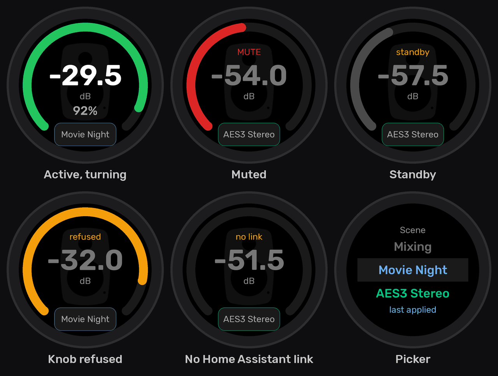

# espgensam_dial

**espgensam_dial** is [ESPHome](https://esphome.io/) firmware that turns an **M5Stack Dial v1.1**
into a physical remote control — primarily a volume knob — for a Genelec SAM monitor system driven
by [`espgensam`](https://github.com/markbergsma/espgensam).

Turning the knob changes volume; the round display shows the level, in dB or as a percentage, and
the condition of the system at a glance.

---

## Purpose

`espgensam` already exposes a Genelec SAM system to Home Assistant over the GLM RS-485 bus. But the
only ways to change volume were a Home Assistant slider and Genelec's own GLM software, and neither
fits the thing you do most often at a desk: reach out and turn a knob.

---

## Features

- **Accelerated volume knob** — 0.5 dB per detent when turning slowly for fine trim, scaling to
  3 dB per detent on a fast spin, so the full −80…−25 dB range is under three revolutions.
- **Zero-latency display** — the arc and readout update from local state on the detent itself, not
  after a network round trip.
- **Live tracking** — the monitors follow the knob during a spin, not just when it stops (see
  [How volume changes reach the monitors](#how-volume-changes-reach-the-monitors)).
- **Honest state** — the ring shows at a glance whether the level is the one you hear, and the
  badge says why not: GLM bus lockout, standby, wake-up progress or loss of the Home Assistant link.
- **Runtime bounds discovery** — volume min/max/step are read from Home Assistant, so nothing is
  hardcoded and espgensam's configuration can change freely.
- **Scenes and group presets** — apply a Home Assistant scene, or switch between the GLM groups
  espgensam has configured, picked from one list on the screen and confirmed with the button.
  Which scenes appear is chosen with a label in Home Assistant, with no reflash.

---

## Controls

| Input | Gesture | Action |
|---|---|---|
| Knob | turn | volume, with acceleration |
| Front button | short press | mute / unmute |
| Front button | long press (≥ 800 ms) | monitors on / off |
| Screen | tap | wake the backlight only — never changes audio |
| Picker button (bottom of the screen) | tap | open the picker; if the screen is dimmed, only wake it |

The picker lists your scenes first, then the group presets. The title above the list says which
kind the highlighted row is.

| Input | Gesture | Action |
|---|---|---|
| Knob | turn | move through the list |
| Front button | short press | apply the highlighted scene or group |
| Front button | long press | cancel |
| Screen | tap | cancel |

The picker closes on its own after 8 s without input. It opens on the scene applied last, or
else on the group in use.

Scenes and groups differ on a second press. Confirming the group already in use changes nothing.
Confirming a scene always applies it, even the one applied last, so pressing it again puts the
room back the way that scene sets it.

While Genelec's GLM software owns the bus, scenes can still be applied but groups cannot.

The picker button shows the scene applied last, or the group in use if no scene has been applied.
Set `picker_button_shows: "group"` in `espgensam_dial.yaml` to show the group instead; the picker
offers both either way. A scene applied from elsewhere (Home Assistant itself, an automation) shows up the next time the
dial asks for the scene list: when the picker opens, or at the periodic refresh (`scene_refresh`).

The button is the only thing that opens the picker; a tap anywhere else just wakes the screen. A
tap never changes audio by itself. The picker applies nothing until you press the button, so picking
the device up or brushing it can never change monitor level, switch groups or apply a scene.

---

## Display



*The main screen in its most common states, and the picker. Rendered from the screen layout, not
photographed.*

The ring is green when the level shown is the level you hear, red when muted, grey when the
level is held (standby, waking or no monitors), and empty when the dial has no control. It
flashes amber when a turn is refused.

The knob is refused while Genelec's GLM adapter owns the bus or the Home Assistant link is down,
and the badge says which. In standby a turn still sets the level, ready for power-on.

`primary_readout` in `espgensam_dial.yaml` chooses whether the large number is dB (`db`, the
default) or the percentage (`percent`).

After 20 s idle the backlight dims but never blanks, so the level stays readable across the room.

---

## Supported hardware

### M5Stack Dial v1.1 (`packages/board_m5stack_dial.yaml`)

| Item | Detail |
|---|---|
| **MCU** | M5Stamp-S3A — ESP32-S3FN8, 8 MB flash, 512 KB SRAM, **no PSRAM** |
| **Display** | GC9A01A 240×240 round TFT, SPI |
| **Touch** | FT3267 (ESPHome `ft5x06` driver), I²C `0x38` |
| **Encoder** | 16 detents / 64 pulses per revolution |
| **RTC** | PCF8563, I²C `0x51` |
---

## Architecture

```
espgensam_dial.yaml            identity, network, and every tunable as substitutions
packages/
  board_m5stack_dial.yaml      HARDWARE ONLY — swap this file for a different dial controller
  target_espgensam_ha.yaml     TRANSPORT — the only file that knows Home Assistant exists
  control.yaml                 input, optimistic state, writes, reconciliation
  ui_volume.yaml               LVGL fonts, volume page, repaint
  ui_picker.yaml               LVGL picker for scenes and group presets
include/dial_state.h           the DialState and UiMode vocabulary and their rules
```

Two seams: `control.yaml` and the `ui_*.yaml` packages never name a Home Assistant
entity; they reach the controlled system only through the transport's `target_*` scripts
(`target_set_volume`, `target_set_group`, `target_activate_scene` and so on) and read its condition
only from globals the transport package writes. See
[AGENTS.md](AGENTS.md) for the full contract.

That is what makes a planned UDP-direct transport a one-file change, and a different dial
controller a one-file change in the other direction.

### How volume changes reach the monitors

The dial updates its own display on every detent and sends each new value straight to Home
Assistant. It does not pace itself: espgensam coalesces volume requests and sends them to the
monitors between telemetry polls, at most every 50 ms by default (its `volume_tx_interval`), so a
fast spin cannot disturb the RS-485 bus.

A reconciler then has to tell three things apart: the echo of the dial's own write, a stale value
arriving while the user is still turning, and a genuine external change (a Home Assistant slider,
Genelec's GLM software, or espgensam rejecting a write and snapping back). It does this with a
600 ms grace period keyed on the last local change and the last write.

---

## Getting started

### 1. Configure secrets

```bash
cp secrets.yaml.example secrets.yaml
```

Fill in Wi-Fi credentials and an API key. A dedicated `api_key` per device is recommended over
reusing espgensam's.

### 2. Point it at your espgensam

**Do this before the first flash.** `espgensam_dial.yaml` ships the entity IDs that espgensam's
*committed* configuration produces:

```yaml
ent_volume:     "number.genelec_sam_controller_volume_db"
ent_media:      "media_player.genelec_sam_system"
ent_bus_status: "sensor.genelec_sam_controller_bus_status"
ent_group:      "select.genelec_sam_controller_group_preset"
```

Yours will very likely differ. ESPHome derives entity IDs from the device friendly name plus the
entity name, and either may have been renamed in Home Assistant afterwards — renames stick, so the
ID can end up looking nothing like the YAML. Check all four in **Developer Tools → States**. A
wrong one makes that value read `unknown` forever, with no error.

`ent_group` is optional. espgensam only has a group preset select if its configuration defines
groups (`groups:` or `sam_file:`) and declares `group_select: name: "Group Preset"`. Without it
the dial works as before, and a tap only wakes the screen.

### 3. Choose the scenes

In Home Assistant, give the label **`dial`** to each scene the dial should offer (Settings → Areas,
labels & zones → Labels, or a scene's settings). The dial asks Home Assistant for the scenes
carrying that label when it connects, every time the picker opens, and every 60 minutes. So
labelling or unlabelling a scene changes the list without a reflash.

Scenes are listed alphabetically by name, so you can order them with a prefix such as
"1 Movie night", "2 Mixing". A different label name goes in `scene_label` in
`espgensam_dial.yaml`. Leaving it empty turns scenes off.

This needs a Home Assistant recent enough to send action responses to ESPHome devices, and the
permission in step 5. To preview what the dial will receive, paste the `response_template` from
`target_refresh_scenes` in `packages/target_espgensam_ha.yaml` into **Developer Tools → Template**.

### 4. Build and flash

```bash
esphome compile espgensam_dial-local.yaml    # or espgensam_dial.yaml if you edited it directly
```

then flash the resulting firmware.

### 5. Allow the dial to perform Home Assistant actions

**Required, and easy to miss.** In Home Assistant: Settings → Devices & Services → ESPHome →
the dial's entry → **Configure** → enable **"Allow the device to perform Home Assistant
actions"**.

Reading state needs no permission, but *every* write — volume, mute, power, group and scene
alike — goes through a Home Assistant action and is gated by this single option, as does fetching
the scene list. With it off the dial looks like it is
working: the screen tracks the knob perfectly and reads espgensam's state correctly, but nothing
ever reaches the monitors.

How to recognise it:

| Where | What you see |
|---|---|
| `esphome logs espgensam_dial.yaml` | `Home Assistant action 'number.set_value' dropped; client has not subscribed to actions (yet)` |
| Home Assistant log | `... rejected; If you trust this device and want to allow access for it to make Home Assistant service calls, you can enable this functionality in the options flow` |

Either message means this option. The dial also logs one `write: ...` line per outbound change, so
the device log shows plainly whether a write was attempted and whether it left the device.

---

## Notes

- **0% means −80 dB, not silence.** espgensam treats only a slider value ≤ 0.001 as true silence
  (−130 dB), and that case is unreachable when driving it in dB.
- **Volume bounds are discovered at runtime** from the Home Assistant `number` entity's `min`,
  `max` and `step` attributes, a few seconds after the API connects. Until then the readout shows
  `--%` and the arc stays empty. This is why espgensam's committed `-30.0` maximum and the
  `-25.0` in its `espgensam-atoms3-rs485-iso-local.yaml` both work with no change here.
- **`--.-` means the volume itself is unknown**, not zero — the dial has had no usable value from
  Home Assistant yet, or the entity has gone unavailable. The knob is refused in that state on
  purpose: a detent is a *relative* change, so without a known starting point it would jump the
  system to an arbitrary level.
- **If an entity id is wrong, nothing errors.** Home Assistant simply sends no state, so the value
  sits empty forever. About 30 s after boot the dial logs a warning naming any of the three
  required entities that never reported, and an info line if the group select or the scene list
  did not — worth checking for on a first flash.
- **The dial depends on Home Assistant.** espgensam itself is autonomous, but an HA-mediated remote
  is not; the empty ring and "no link" badge make that visible rather than pretending. A UDP transport
  straight to espgensam is the planned fix.

---

## License

[GNU General Public License v3.0](LICENSE), matching `espgensam`.
